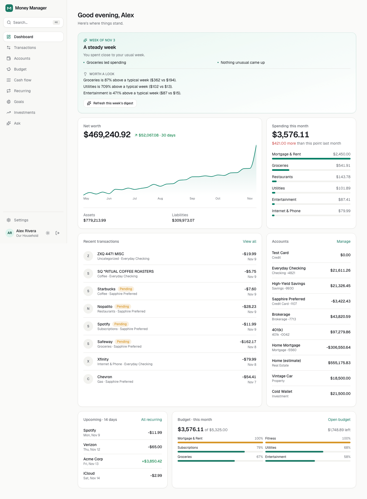

# Money Manager

[](https://github.com/nathanielnoyd/money-manager/actions/workflows/ci.yml)
[](LICENSE)

Self-hosted personal finance for a household. Accounts, transactions, budgets, cash flow, recurring bills, investments, goals and credit card rewards, running on a server you control.



## Who it's for

People who want a full picture of their money without handing it to a subscription service, and who are comfortable running a Docker Compose stack.

## What it does

| Area                   | Capability                                                                                               |
| ---------------------- | -------------------------------------------------------------------------------------------------------- |
| Accounts and net worth | Bank, card, loan, investment and manual accounts, with net worth over time                               |
| Transactions           | Search, filters, splits, bulk edits, rules, merchant cleanup, transfer detection, duplicate-safe imports |
| Budgets and cash flow  | Monthly budgets with rollover, income vs. spending by category and merchant, savings rate                |
| Recurring              | Subscriptions and bills detected automatically, with upcoming charges and price-increase alerts          |
| Investments and goals  | Holdings, allocation and returns; savings goals tracked against real balances                            |
| Card rewards           | What each purchase earned, which card to use, whether each card is worth its fee                         |
| Household              | Owner, member and viewer roles                                                                           |
| Alerts                 | Push notifications through ntfy                                                                          |
| Agents (MCP)           | Let an AI agent read your data and make scoped changes, with revocable tokens                            |
| AI (optional)          | Plain-English questions, suggested categories and a weekly digest, using your own Anthropic key          |
| Export                 | Every transaction as CSV, or the whole household as JSON                                                 |

Bank data comes from SimpleFIN, Plaid or Teller using your own accounts with them, or from CSV, OFX, QFX and QBO files.

## Principles

- **Your server, your data.** Everything lives in a Postgres database you run. No telemetry, no analytics.
- **Nothing exposed to the internet.** No container publishes a port. You reach the app through Tailscale or Cloudflare Tunnel with Access.
- **No passwords.** Sign-in uses passkeys, with single-use recovery codes and optional TOTP.
- **Least privilege.** Postgres row-level security isolates each household. Only the background worker can decrypt bank credentials.
- **AI is opt-in.** Nothing is sent to an AI provider until a household owner turns it on and sees what is shared.

## Limits

- Built for the US: amounts are shown in US dollars, and totals don't convert other currencies.
- One time zone per server.
- No native mobile app; the web app works in a phone browser.

## Get started

Run it on any Linux machine with Docker (a home server, a mini PC or a small cloud VM):

```bash
git clone https://github.com/nathanielnoyd/money-manager && cd money-manager
pnpm install && pnpm keys:generate   # creates ./secrets; back it up offline
cp .env.example .env                 # set APP_URL, ACCESS_MODE and TZ
docker compose up -d --build
docker compose logs migrate          # copy the one-time setup token
```

Open your `APP_URL`, paste the token and create your passkey. The [self-hosting guide](docs/self-hosting.md) covers access, bank connections and backups step by step.

## Documentation

| Guide                                      | Covers                                                |
| ------------------------------------------ | ----------------------------------------------------- |
| [Self-hosting](docs/self-hosting.md)       | Install, secure access, banks, backups                |
| [Security](docs/security.md)               | Threat model and controls                             |
| [Upgrading](docs/upgrading.md)             | Updating, verifying release images, rolling back      |
| [Card rewards](docs/rewards.md)            | Wallet setup, the card catalog and keeping it current |
| [Agents (MCP)](docs/agents.md)             | Connecting an AI agent safely                         |
| [Customizing](docs/customizing.md)         | Extending the app or running your own fork            |
| [Architecture](docs/architecture.md)       | How the services and packages fit together            |
| [Troubleshooting](docs/troubleshooting.md) | Common problems and fixes                             |
| [FAQ](docs/faq.md)                         | Short answers                                         |
| [Contributing](CONTRIBUTING.md)            | Development setup and the rules reviewers check       |

## Security

Report vulnerabilities privately as described in [SECURITY.md](SECURITY.md).

## License

[GNU Affero General Public License v3.0 or later](LICENSE). If you run a modified version for other people over a network, you must offer them its source code (set `SOURCE_URL`; the app links to it).

The bundled card catalog is built from [Open Credit Card Benefits](https://github.com/nathanielnoyd/open-credit-card-benefits) (CC BY 4.0).
