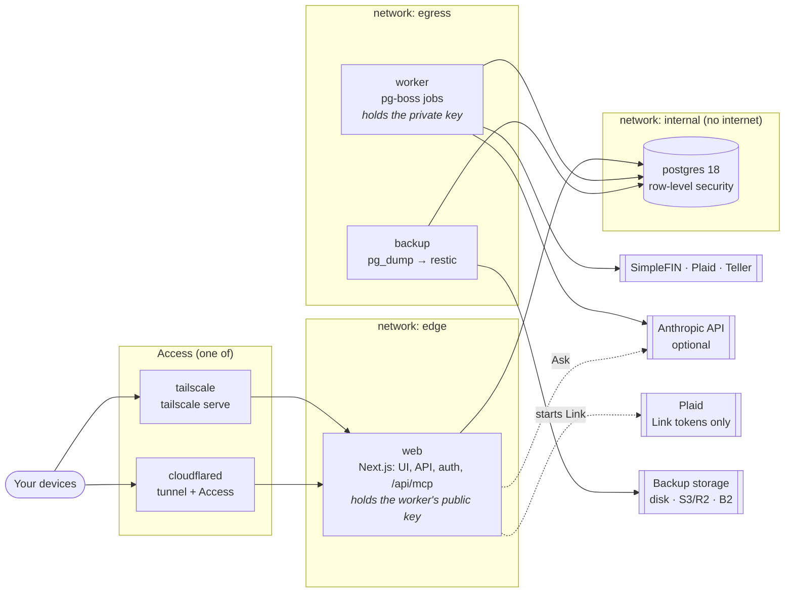
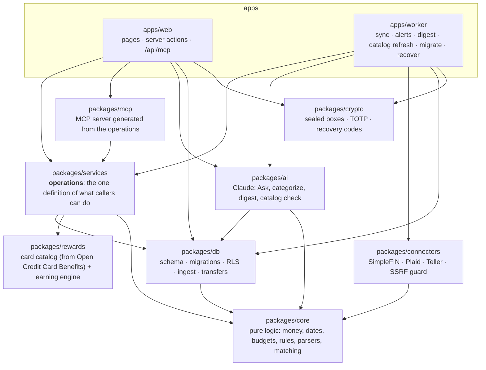

# Architecture

How Money Manager fits together: which containers run, what each one can reach and decrypt, and how a request, a bank sync and an agent call travel through the code. For the threat model behind these choices, read [security.md](security.md).

## Containers and networks

| Service                     | Can reach                                                               | Holds                                                                                   |
| --------------------------- | ----------------------------------------------------------------------- | --------------------------------------------------------------------------------------- |
| `web`                       | Postgres; outbound through `edge` (Access keys, Plaid, Anthropic, ntfy) | The worker's **public** key, the session/TOTP encryption key, the app database password |
| `worker`                    | Postgres; outbound through `egress` (bank aggregators, Anthropic, ntfy) | The worker's **private** keys, the app database password                                |
| `migrate`                   | Postgres only; runs once at start-up, then exits                        | The database **admin** password                                                         |
| `db`                        | Nothing outside `internal`                                              | Your data                                                                               |
| `backup`                    | Postgres and your backup destination                                    | The admin password and the restic password                                              |
| `tailscale` / `cloudflared` | `web` on `edge`, and their own control planes                           | The tailnet auth key or tunnel token                                                    |

No container publishes a port on the host. The access container is the only way in, and the web app checks the Tailscale identity header or the Cloudflare Access JWT on every request as a second gate before its own passkey sign-in.

**Why two keys.** When you link a bank, the web app seals the token to the worker's public key ([`packages/crypto`](../packages/crypto)). Only the worker can open it. A compromised web container can write new bank connections but can't read existing ones.

## Code layout

`packages/core` has no I/O, which is why most domain logic lives there with its tests next to it. Everything that touches household data goes through `withHousehold()` in `packages/db`.

## A request from the browser

1. The access container forwards the request to `web:3000`.
2. `apps/web/src/proxy.ts` runs first: it checks the access gate, redirects to `/login` without a session cookie, and sets a per-request CSP nonce.
3. A page or server action loads the session. Server actions check the role (`denyUnless`, or `requireStepUp` for sensitive ones) before doing anything, and validate input with Zod.
4. Data is read and written inside `withHousehold(db, householdId, …)`. That opens a transaction and sets `app.household_id`, and Postgres row-level security limits every household table to that household. With no household set, queries return nothing.

Most writes go through an **operation** (`runOperation(...)`), so the same code runs whether a person clicks a button, Ask answers a question, or an agent calls a tool.

## Operations: one definition, three callers

An operation in [`packages/services/src/operations`](../packages/services/src/operations) declares its name, a description written for an agent, a Zod input schema, the minimum role and the token scope it needs. `execute()` checks those, then runs it inside `withHousehold()`.

- **The UI** calls it through `runOperation()` in a server action.
- **Ask** gets the read-only ones as Claude tools.
- **MCP** (`/api/mcp`) turns every operation into a tool automatically. An agent token can never act above the role of the person who created it, and admin actions (bank linking, members, security, AI settings, export, account deletion) are not operations at all.

See [customizing.md](customizing.md) to add one.

## A bank sync

1. Every 15 minutes (`SYNC_CRON`) the worker asks `due_connections()`, a narrow `SECURITY DEFINER` function that returns only ids, which connections are due. "Sync now" and new links also arrive at once through Postgres `NOTIFY`.
2. Each connection becomes a job on the `sync-connection` queue, at most one running and one waiting per connection.
3. The worker opens the sealed token in memory, calls the aggregator with no database transaction open, and then writes inside the household's RLS scope:
   - `ingestTransactions()` cleans merchant names, applies rules, reconciles pending → posted (keeping your edits and splits), and records removed rows;
   - `detectTransfers()` files card payments and moves between your accounts;
   - recurring series are refreshed.
4. After the sync, optional AI categorization runs on new uncategorized rows, then alerts are checked and sent through ntfy.

File imports take the same `ingestTransactions()` path from the web app, tagged with an import id so they can be removed later.

## Scheduled jobs

| Job               | When (in `TZ`)                          | What                                                 |
| ----------------- | --------------------------------------- | ---------------------------------------------------- |
| `sync-scheduler`  | `SYNC_CRON`, every 15 minutes           | Queues due bank connections                          |
| `maintenance`     | Hourly                                  | Expires sessions and challenges                      |
| `weekly-digest`   | `DIGEST_CRON`, Monday 8:00              | Queues one digest job per opted-in household         |
| `catalog-refresh` | `CATALOG_REFRESH_CRON`, the 3rd at 9:00 | Queues one card catalog check per opted-in household |
| `demo-reset`      | `DEMO_RESET_CRON`, demo mode only       | Rebuilds the demo household                          |

## Where to go next

- [security.md](security.md): threat model and every control in detail.
- [self-hosting.md](self-hosting.md): running it.
- [CONTRIBUTING.md](../CONTRIBUTING.md) and [AGENTS.md](../AGENTS.md): working on the code, and the invariants reviewers check.
